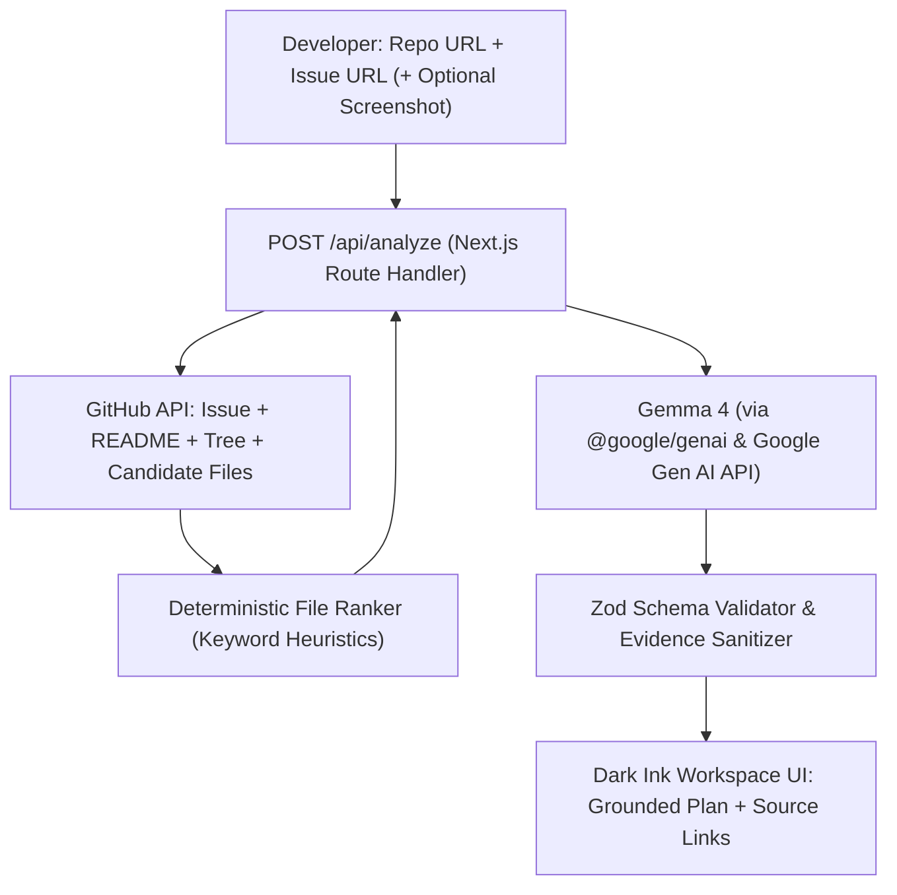

# PatchPath

> **Start with an issue. Leave with a plan.**

PatchPath is an open-source developer orientation assistant built with **Next.js**, **TypeScript**, **Tailwind CSS**, and **Gemma 4** via the Google Gen AI SDK (`@google/genai`).

When developers encounter an unfamiliar open-source repository, understanding an issue and knowing what to inspect first is daunting. PatchPath gathers real repository context directly from GitHub, feeds bounded evidence to Gemma 4, and synthesizes a structured, inspectable first-contribution plan.

---

## Key Features

- **Grounded in Repository Facts:** Fetches live issue metadata, README, default branch file tree, and samples candidate text files via the GitHub REST API.
- **Inspectable Source Links:** Every file recommendation links directly to the real file on GitHub. No invented paths or hallucinations.
- **Clear Verification Badges:**
  - Commands are explicitly marked **`DOCUMENTED`** (found in project documentation) vs **`SUGGESTED`** (inferred best practice).
  - Investigation steps are marked **`VERIFIED`** vs **`NEEDS VERIFICATION`**.
- **Optional Multimodal Screenshot Analysis:** Upload error screenshots (PNG, JPG, WebP) to correlate visual errors with repository code.
- **Prioritized "Start Here" Guidance:** Caps starting steps at 3 prioritized actions so contributors aren't overwhelmed.
- **Export & Share:** Export or copy contribution plans directly as formatted Markdown.
- **Untrusted Input Protection:** Treats all repository code and issue descriptions as untrusted prompt data with strict system instructions to mitigate prompt injection.
- **Zero Arbitrary Execution:** Never executes repository code or opens unverified pull requests.

---

## Architecture & How It Works



1. **URL Validation:** Parses and validates that both URLs point to `github.com` and target the same repository.
2. **Evidence Collection:** Requests issue details, README, and the default branch tree.
3. **Candidate Sampling:** Ranks paths using issue title/body keywords, excluding binaries and build directories (`node_modules`, `dist`, etc.), and samples top candidate files (bounded by byte caps).
4. **Gemma 4 Reasoning:** Invokes Gemma 4 with bounded repository evidence, the optional screenshot, and strict JSON output formatting.
5. **Validation & Rendering:** Schema-validates the response with Zod, ensures all file paths link to real GitHub sources, and renders the result in a calm, dark-themed workspace.

---

## Getting Started

### 1. Prerequisites

- **Node.js** 20+ (Node.js 22 or 24 recommended)
- **npm**, **pnpm**, or **yarn**
- A **Google AI Studio API key** ([Get a key](https://aistudio.google.com/apikey))

### 2. Installation

Clone the repository and install dependencies:

```bash
git clone https://github.com/your-username/patchpath.git
cd patchit
npm install
```

### 3. Configure Environment Variables

Copy the example environment file:

```bash
cp .env.example .env.local
```

Edit `.env.local`:

```dotenv
# Google AI Studio / Gemini API key (Server-side only)
GEMINI_API_KEY=your_gemini_api_key_here

# Gemma 4 model candidate
GEMMA_MODEL=gemma-4-26b-a4b-it

# Optional: GitHub personal access token for higher rate limits (5,000 req/hr vs 60 req/hr)
GITHUB_TOKEN=
```

> **Note:** If no `GEMINI_API_KEY` is provided during initial setup, PatchPath includes built-in preloaded examples (React and Next.js) so you can test the UI and workflow immediately.

### 4. Run Development Server

```bash
npm run dev
```

Open [http://localhost:3000](http://localhost:3000) in your browser.

### 5. Run Tests

PatchPath comes with unit tests covering URL parsing, repository matching, Zod response validation, and candidate ranking heuristics:

```bash
npm test
```

### 6. Production Build

```bash
npm run build
npm run start
```

---

## API Reference

### `POST /api/analyze`

Analyzes a public GitHub issue and repository to produce a contribution plan.

**Request Body (JSON):**

```json
{
  "repositoryUrl": "https://github.com/facebook/react",
  "issueUrl": "https://github.com/facebook/react/issues/28000",
  "screenshotBase64": "optional_base64_string",
  "screenshotMimeType": "image/png"
}
```

**Success Response (200 OK):**

```json
{
  "plan": {
    "issueSummary": "Summary of the issue...",
    "suspectedArea": "Affected module or subsystem...",
    "firstSteps": [
      {
        "title": "Inspect helper configuration",
        "explanation": "Why this matters...",
        "evidenceIds": ["source-file-0"],
        "verification": "verified"
      }
    ],
    "relevantFiles": [
      {
        "path": "packages/react-refresh/src/__tests__/ReactFreshMultipleRenderer-test.js",
        "reason": "Direct test suite referencing the legacy renderer helper.",
        "githubUrl": "https://github.com/facebook/react/blob/main/packages/...",
        "evidenceIds": ["source-file-0"],
        "confidence": "high"
      }
    ],
    "reproduction": [
      {
        "instruction": "yarn test packages/react-refresh",
        "source": "README.md",
        "verification": "documented"
      }
    ],
    "openQuestions": ["Unresolved questions..."],
    "limitations": ["Analysis boundaries..."]
  },
  "issue": {
    "number": 28000,
    "title": "Convert ReactFreshMultipleRenderer to createRoot",
    "state": "open",
    "labels": ["Component: Fast Refresh"],
    "htmlUrl": "https://github.com/facebook/react/issues/28000"
  },
  "evidenceSummary": {
    "fileCount": 4,
    "hasReadme": true,
    "treeTotalFiles": 7909,
    "analyzedFiles": ["..."]
  },
  "modelUsed": "gemma-4-26b-a4b-it"
}
```

---

## Design System & Theme

PatchPath uses a focused, quiet developer workspace palette:

| Token | Hex | Usage |
|---|---|---|
| Background | `#0B111B` | Deep navy canvas |
| Surface Main | `#111A27` | Content containers |
| Surface Raised | `#172233` | Inputs, code blocks, cards |
| Surface Border | `#273548` | Dividers and field borders |
| Primary Accent | `#48C9A4` | Main CTA and verified states |
| Accent Hover | `#35B58D` | Interactive hover states |
| Warning / Unverified | `#E8B66A` | Inferred suggestions & cautions |
| Error | `#F08080` | Validation errors |
| Link / Information | `#8AB8F9` | Source links & metadata |

---

## Safety & Boundaries

- **Never runs repository code:** PatchPath reads public repository text and metadata; it never installs dependencies or executes arbitrary code.
- **Prompt Injection Defense:** Model instructions strictly treat all repository content, issue descriptions, and screenshots as untrusted data.
- **Secret Protection:** Secrets (`GEMINI_API_KEY`, `GITHUB_TOKEN`) are strictly accessed in server-side route handlers and are never exposed to client bundles.
- **Read-only GitHub access:** No write permissions, repository alteration, or automated PR creation.

---

## License

This project is licensed under the [MIT License](LICENSE).
